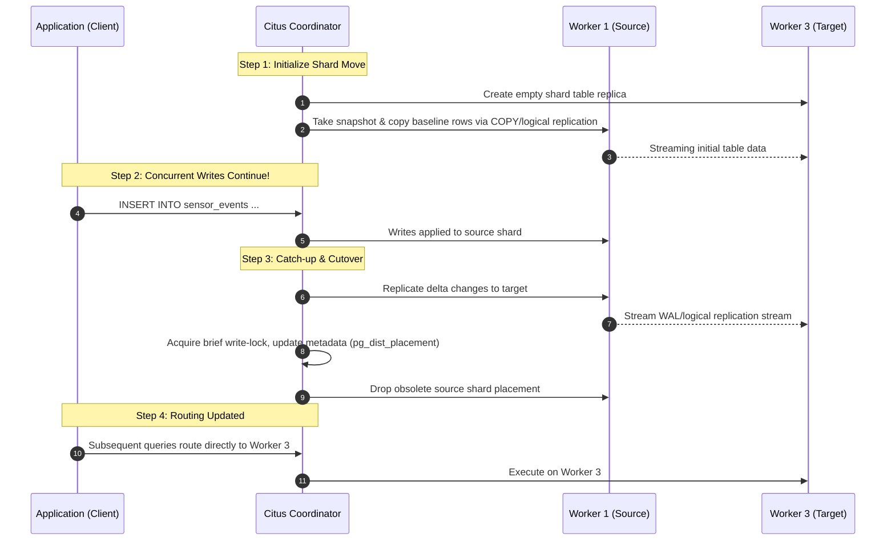

# Example 06: Shard Rebalancing & Cluster Scaling

## Overview

In a distributed database, scaling out hardware resources requires moving data between machines without taking the cluster offline or violating transactional consistency. **Citus provides online shard rebalancing**, enabling zero-downtime cluster expansion, graceful node decommissioning (draining), manual shard migrations, and online shard splitting.

This module demonstrates:
1. **Manual online shard movement** via [`citus_move_shard_placement`](https://docs.citusdata.com/en/v12.0/develop/reference_sql.html#citus-move-shard-placement).
2. **Online shard splitting** via [`citus_split_shard_by_split_points`](https://docs.citusdata.com/en/v12.0/develop/reference_sql.html#citus-split-shard-by-split-points).
3. **Graceful node draining** for server maintenance or retirement via [`citus_drain_node`](https://docs.citusdata.com/en/v12.0/develop/reference_sql.html#citus-drain-node).
4. **Automated cluster rebalancing** via [`citus_rebalance_start`](https://docs.citusdata.com/en/v12.0/develop/reference_sql.html#citus-rebalance-start) and [`rebalance_table_shards`](https://docs.citusdata.com/en/v12.0/admin_guide/cluster_management.html#rebalancing-shards).
5. **Zero-downtime validation**: Writing concurrent transactions while shards are actively moving.

---

## Architecture & Shard Movement Lifecycle



---

## Citus Rebalancing Features & Primitives

### 1. Shard Transfer Modes
When moving or splitting shards, Citus supports different replication mechanisms:
- `auto` (default): Prefers Postgres logical replication if tables have a `PRIMARY KEY` or `REPLICA IDENTITY`; otherwise falls back to blocking writes during data copy.
- `block_writes`: Holds a read-only lock (`ShareLock`) on the moving shard throughout the copy process. Reads continue, but writes are blocked until transfer finishes. Ideal for environments where logical replication slots cannot be provisioned or tables lack primary keys.
- `force_logical`: Forces logical replication. Fails if requirements (e.g., identity keys) are missing.

### 2. Shard Splitting (`citus_split_shard_by_split_points`)
When a shard becomes disproportionately large or hot, Citus allows splitting the 32-bit integer hash space of that shard into multiple smaller ranges. Co-located tables are automatically split in tandem, maintaining 100% co-location consistency.

### 3. Node Draining (`citus_drain_node`)
When decommissioning a node or performing operating system maintenance:
```sql
SELECT citus_drain_node('citus_worker_3', 5432, shard_transfer_mode => 'block_writes');
```
This single command marks `shouldhaveshards = false` in `pg_dist_node` and migrates all existing shards off that node to remaining healthy workers.

### 4. Cluster Rebalancing (`rebalance_table_shards` / `citus_rebalance_start`)
When a new worker is added or a drained worker is restored:
```sql
SELECT citus_set_node_property('citus_worker_3', 5432, 'shouldhaveshards', true);
SELECT rebalance_table_shards(shard_transfer_mode => 'block_writes');
```
Citus computes a shard placement plan that balances shard counts and disk space evenly across all active workers.

---

## File Structure

```
examples/06-rebalancing-and-scaling/
├── README.md       # Comprehensive documentation and architecture guide
├── schema.sql      # Sensor fleet and telemetry distributed tables (co-located)
├── data.sql        # 12 fleets, 12,000 sensor events
├── queries.sql     # Manual move, split, drain, restore, and rebalance queries
├── verify.sh       # Executable test harness with background concurrent writer
├── verify.sql      # Automated SQL assertions (placement balance, row counts)
└── cleanup.sql     # Teardown tables and restore cluster balance
```

---

## How to Run & Verify

### 1. Execute the Automated Suite
```bash
./examples/06-rebalancing-and-scaling/verify.sh
```

### Expected Output
```text
=== [06-rebalancing-and-scaling] Starting Test Suite ===
--> Verifying Citus coordinator connection...
/var/run/postgresql:5432 - accepting connections
--> Applying schema.sql...
--> Loading data.sql (12 fleets, 12,000 sensor events)...
--> Starting concurrent background writer to prove online shard mobility...
--> Executing queries.sql (manual move, split, drain, restore, rebalance)...
NOTICE:  Moving shard 102584 from citus_worker_1 to citus_worker_2...
NOTICE:  Splitting shard 102582 at split point -1073741825 onto nodes 2, 4...
NOTICE:  Moving shard ... from citus_worker_3 to citus_worker_1 ...
NOTICE:  Moving shard ... to citus_worker_3 ...
--> Waiting for background writer to complete...
--> Running automated verification assertions...
NOTICE:  [PASS] Tables sensor_fleets and sensor_events are properly distributed
NOTICE:  [PASS] Co-located shard counts match perfectly (8 shards each)
NOTICE:  [PASS] All 3 worker nodes are active and configured to hold shards
NOTICE:  [PASS] All active worker nodes hold balanced shard placements
NOTICE:  [PASS] Row count integrity verified: 12 fleets, 12040 events
=== [06-rebalancing-and-scaling] ALL CHECKS PASSED SUCCESSFULLY ===
```

---

## Metadata & EXPLAIN Inspection

### Check Shard Count per Node
```sql
SELECT
    n.nodename,
    n.shouldhaveshards,
    count(s.shardid) AS shard_count
FROM pg_dist_node n
LEFT JOIN citus_shards s ON s.nodename = n.nodename AND s.table_name = 'sensor_fleets'::regclass
GROUP BY n.nodename, n.shouldhaveshards
ORDER BY n.nodename;
```

### Track Background Rebalance Job Progress
```sql
SELECT
    job_id,
    state,
    job_type,
    description,
    started_at,
    finished_at
FROM citus_rebalance_status();
```

---

## Pitfalls & Trade-offs

1. **Rebalancing Overhead & I/O Spikes**: Moving shards copies entire table files across the network. Running rebalance during peak application traffic can saturate network bandwidth and increase I/O wait on source/target workers. Always tune `citus.shard_transfer_mode` and execute heavy rebalances during maintenance windows.
2. **Metadata Cache Invalidation**: Commands modifying node properties (like `citus_set_node_property`) must commit before calling `rebalance_table_shards` in a subsequent transaction, otherwise the planner evaluates stale cached node metadata.
3. **Transaction Context Restrictions**: Citus administrative routines (`citus_move_shard_placement`, `citus_split_shard_by_split_points`, `citus_drain_node`) manage distributed transactions internally and **cannot be run inside a transaction block where prior table modifications occurred**.
4. **Co-location Propagation**: Splitting a shard in a table automatically splits all tables in the co-location group. If a colocation group contains dozens of large tables, splitting an oversized shard will trigger split operations across all tables in that group.
