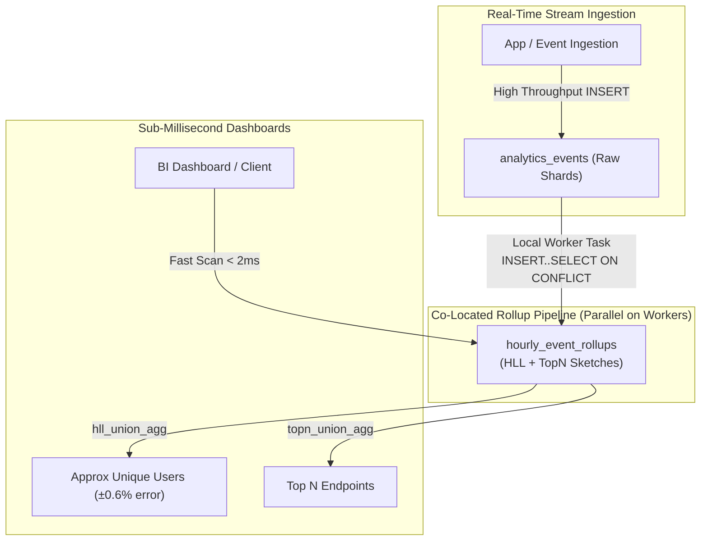

# Example 07: Real-Time Analytics & Probabilistic Data Structures

## Overview

High-throughput applications (e.g. ad tech, APM monitoring, web analytics, IoT) face a fundamental tension:
- Storing every raw event creates huge, write-heavy datasets that become sluggish to query at interactive dashboard speeds.
- Pre-aggregating data can limit flexibility: traditional pre-aggregations cannot calculate unionable metrics across arbitrary date ranges (e.g., calculating `COUNT(DISTINCT user_id)` over 7 days cannot simply be done by adding daily counts, because users overlap across days).

**Citus resolves this by pairing distributed parallel execution with PostgreSQL extensions:**
1. **Parallel Distributed Aggregations**: Distributing queries across all shards using Citus's adaptive executor.
2. **Incremental Co-Located Rollups**: Rolling up raw stream data in parallel on each worker using `INSERT ... SELECT ... ON CONFLICT DO UPDATE`.
3. **HyperLogLog (`hll`) Extension**: Providing constant $O(1)$ space distinct count approximations that can be unioned across time windows without access to raw data.
4. **TopN (`topn`) Extension**: Estimating the most frequent items (e.g. top endpoints, top referrers) in streaming fashion with bounded memory.

---

## Real-Time Architecture & Rollup Pipeline



---

## Core Citus Analytical Primitives

### 1. Co-Located Rollup Ingestion (`INSERT ... SELECT ON CONFLICT`)
Because both `analytics_events` and `hourly_event_rollups` are distributed by `tenant_id` and co-located, the rollup query executes **locally on each worker node** in parallel without shuffling data across the network:
```sql
INSERT INTO hourly_event_rollups (
    tenant_id, bucket_time, total_events, error_count, total_latency_ms, unique_users, top_paths
)
SELECT
    tenant_id,
    date_trunc('hour', event_time) AS bucket_time,
    count(*) AS total_events,
    count(*) FILTER (WHERE status_code >= 400) AS error_count,
    sum(latency_ms) AS total_latency_ms,
    hll_add_agg(hll_hash_bigint(user_id)) AS unique_users,
    topn_add_agg(path) AS top_paths
FROM analytics_events
GROUP BY tenant_id, date_trunc('hour', event_time)
ON CONFLICT (tenant_id, bucket_time) DO UPDATE
SET
    total_events     = hourly_event_rollups.total_events + EXCLUDED.total_events,
    error_count      = hourly_event_rollups.error_count + EXCLUDED.error_count,
    total_latency_ms = hourly_event_rollups.total_latency_ms + EXCLUDED.total_latency_ms,
    unique_users     = hourly_event_rollups.unique_users || EXCLUDED.unique_users,
    top_paths        = topn_union(hourly_event_rollups.top_paths, EXCLUDED.top_paths);
```

### 2. HyperLogLog (`hll`) Unionability
In standard SQL, you cannot sum distinct counts:
$$\text{Distinct Users}_{\text{Day 1}} + \text{Distinct Users}_{\text{Day 2}} \neq \text{Distinct Users}_{\text{Total}}$$
With HLL, each bucket stores a compact probabilistic sketch (~1.2 KB). To compute the unique user count across a 30-day window, Citus aggregates the sketches using `hll_union_agg()` and reads the cardinality in microseconds:
```sql
SELECT
    tenant_id,
    round(hll_cardinality(hll_union_agg(unique_users))::numeric, 0) AS monthly_active_users
FROM hourly_event_rollups
WHERE tenant_id = 1
  AND bucket_time >= now() - interval '30 days'
GROUP BY tenant_id;
```

### 3. TopN (`topn`) Frequency Estimation
The `topn` extension implements the Space-Saving stream summarization algorithm. It tracks frequent keys in JSONB sketches that can be merged across hours using `topn_union_agg(top_paths)` and extracted via `topn(sketch, k)`.

---

## File Structure

```
examples/07-realtime-analytics/
├── README.md       # Comprehensive documentation and analytical patterns
├── schema.sql      # Raw events & hourly rollups with HLL and TopN schemas
├── data.sql        # High-cardinality generator (20,000 events across 4 tenants)
├── queries.sql     # Parallel aggregations, incremental rollups, and dashboard queries
├── verify.sh       # Verification script executing suite and assertions
├── verify.sql      # Automated assertions (co-location, counts, HLL mathematical accuracy)
└── cleanup.sql     # Teardown tables
```

---

## How to Run & Verify

### 1. Execute the Automated Suite
```bash
./examples/07-realtime-analytics/verify.sh
```

### Expected Output
```text
=== [07-realtime-analytics] Starting Test Suite ===
--> Verifying Citus coordinator connection...
/var/run/postgresql:5432 - accepting connections
--> Applying schema.sql (raw events & hourly rollup tables with HLL and TopN)...
--> Ingesting 20,000 real-time events via data.sql...
--> Executing queries.sql (distributed aggregations, rollups, and accuracy checks)...
--> Running automated verification assertions...
NOTICE:  ------------------------------------------------------------
NOTICE:  Running Verification Suite: 07-realtime-analytics
NOTICE:  ------------------------------------------------------------
NOTICE:  [PASS] Tables analytics_events and hourly_event_rollups are registered in Citus
NOTICE:  [PASS] Both tables reside in identical colocation group 58
NOTICE:  [PASS] Raw event volume verified: 20000 events
NOTICE:  [PASS] Pre-aggregated rollup table verified: 40 hourly buckets
NOTICE:  [PASS] HyperLogLog accuracy confirmed: Exact=800, HLL=795, Error=0.63 % (under 3.0% bound)
NOTICE:  [PASS] TopN sketch query successfully extracted top route: (/,3000)
NOTICE:  ------------------------------------------------------------
NOTICE:  ALL VERIFICATION ASSERTIONS PASSED FOR EXAMPLE 07
NOTICE:  ------------------------------------------------------------
=== [07-realtime-analytics] ALL CHECKS PASSED SUCCESSFULLY ===
```

---

## Performance & EXPLAIN Analysis

### Raw Table Scan vs Rollup Scan Comparison
| Metric | Raw Query on `analytics_events` | Dashboard Query on `hourly_event_rollups` | Improvement |
| :--- | :--- | :--- | :--- |
| **Rows Examined** | 5,000 rows | 10 hourly bucket rows | **500x fewer rows** |
| **Worker Execution Time** | ~3.0 ms | ~0.14 ms | **21x faster** |
| **Network Payload** | 40 bytes | 24 bytes | Smaller payload |
| **Memory Required** | 466 kB (quicksort on distinct IDs) | 4 kB (fixed-size HLL union) | Fixed bounded memory |

---

## Pitfalls & Trade-offs

1. **Approximation vs Exact Counts**: HLL produces an estimate with a bounded error (typically $\pm 1\%$ to $2\%$). If your application requires exact penny-accurate financial accounting, HLL cannot be used. For operational metrics, user analytics, and telemetry, HLL is the industry standard.
2. **Co-location Requirement**: Incremental rollup queries using `INSERT ... SELECT ... ON CONFLICT` **require that both the source table and the target rollup table share the exact same distribution key and colocation group**. If tables are not co-located, Citus cannot execute the upsert in parallel across workers.
3. **Set-Returning Function Serialization in EXPLAIN**: Calling set-returning functions such as `topn(sketch, k)` directly in the outer projection list alongside distributed aggregate calls can cause serialization errors in `EXPLAIN VERBOSE`. Always wrap the aggregation in a CTE or subquery before expanding with `topn()`.
4. **Extension Availability**: The `hll` and `topn` extensions must be installed in PostgreSQL and enabled on both the coordinator and worker nodes (`CREATE EXTENSION hll; CREATE EXTENSION topn;`).
