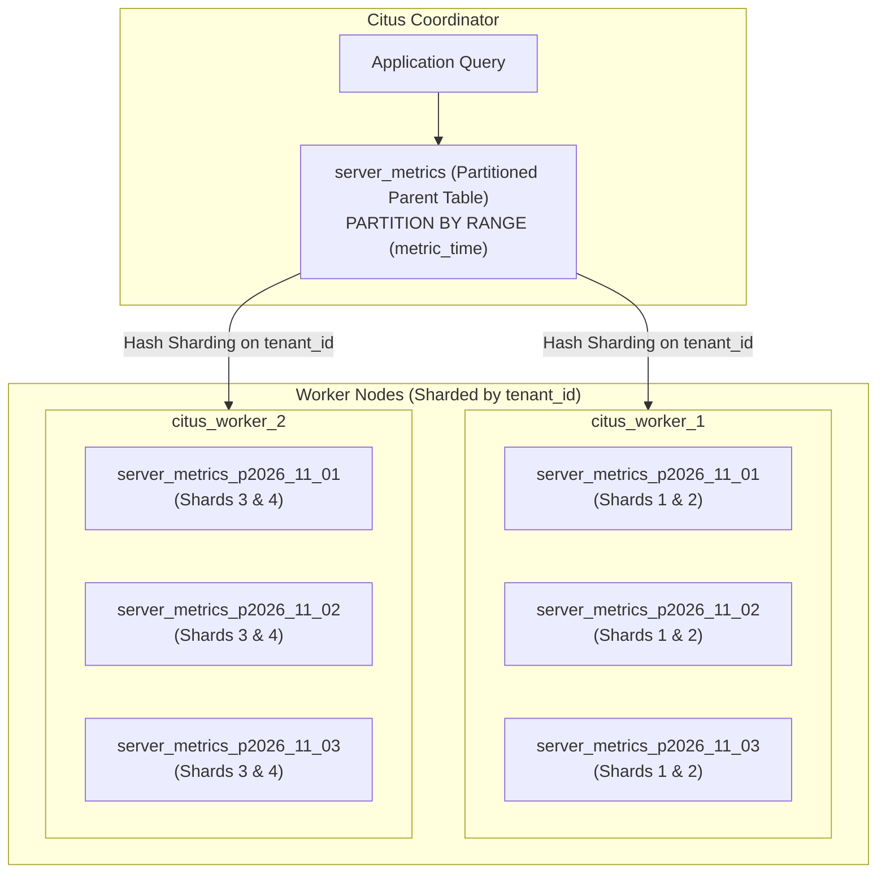

# Example 08: Distributed Time-Series Partitioning

## Overview

Time-series workloads (such as server telemetry, IoT events, application metrics, and financial ticks) generate massive data volumes that quickly degrade single-table performance. Combining PostgreSQL's native declarative range partitioning with Citus horizontal hash sharding creates a **two-dimensional distributed architecture**:
1. **Horizontal Distribution (Hash Sharding by `tenant_id`)**: Distributes queries and data evenly across multiple worker nodes to scale storage capacity and parallel CPU compute.
2. **Local Declarative Partitioning (Range Partitioning by `metric_time`)**: Slices data within each worker into daily or weekly physical partition tables.

This module demonstrates:
- Distributing a natively partitioned table via [`create_distributed_table`](https://docs.citusdata.com/en/v12.0/develop/reference_sql.html#create-distributed-table).
- Automated time-partition creation via [`create_time_partitions`](https://docs.citusdata.com/en/v12.0/develop/reference_sql.html#create-time-partitions).
- Automated zero-vacuum retention enforcement via [`drop_old_time_partitions`](https://docs.citusdata.com/en/v12.0/develop/reference_sql.html#drop-old-time-partitions).
- Multi-dimensional query routing & partition pruning in `EXPLAIN` plans.

---

## Two-Dimensional Sharding & Partitioning Architecture



---

## Core Citus Time-Series Primitives

### 1. Multi-Key Constraint Rule
In a distributed range-partitioned table, primary keys and unique constraints **must include both the distribution column (`tenant_id`) and the range partition column (`metric_time`)**:
```sql
CREATE TABLE server_metrics (
    tenant_id int NOT NULL,
    metric_time timestamptz NOT NULL,
    server_id text NOT NULL,
    cpu_utilization numeric(5,2) NOT NULL,
    PRIMARY KEY (tenant_id, metric_time, server_id)
) PARTITION BY RANGE (metric_time);

SELECT create_distributed_table('server_metrics', 'tenant_id');
```

### 2. Automated Partition Management (`create_time_partitions`)
Citus provides helper functions to pre-create partition tables and their corresponding distributed shards automatically across the cluster:
```sql
SELECT create_time_partitions(
    table_name         => 'server_metrics',
    partition_interval => '1 day'::interval,
    end_at             => now() + interval '2 days',
    start_from         => now() - interval '3 days'
);
```

### 3. Automated Retention Cleanup (`drop_old_time_partitions`)
Deleting millions of rows with `DELETE FROM table WHERE time < ...` causes severe table bloat, WAL pressure, and heavy `VACUUM` load. Dropping old partitions removes files directly in $O(1)$ time with zero WAL overhead:
```sql
CALL drop_old_time_partitions('server_metrics', now() - interval '2 days');
```

---

## File Structure

```
examples/08-timeseries-partitioning/
├── README.md       # Architecture diagram, partition pruning guide, trade-offs
├── schema.sql      # Partitioned server telemetry table and automated partition creation
├── data.sql        # 16,000 multi-day metrics across 4 tenants and 10 servers
├── queries.sql     # Partition inspection, pruning in EXPLAIN, router queries, retention
├── verify.sh       # Executable test harness
├── verify.sql      # Automated assertions (partition count, distributed shards, retention)
└── cleanup.sql     # Teardown script
```

---

## How to Run & Verify

### 1. Execute the Automated Suite
```bash
./examples/08-timeseries-partitioning/verify.sh
```

### Expected Output
```text
=== [08-timeseries-partitioning] Starting Test Suite ===
--> Verifying Citus coordinator connection...
/var/run/postgresql:5432 - accepting connections
--> Applying schema.sql (declarative partitioning + create_time_partitions)...
--> Ingesting 16,000 multi-day metrics via data.sql...
--> Executing queries.sql (partition inspection, pruning in EXPLAIN, retention cleanup)...
NOTICE:  dropping server_metrics_p2026_10_30 with start time 2026-10-30 00:00:00+00 and end time 2026-10-31 00:00:00+00
CALL
--> Running automated verification assertions...
NOTICE:  ------------------------------------------------------------
NOTICE:  Running Verification Suite: 08-timeseries-partitioning
NOTICE:  ------------------------------------------------------------
NOTICE:  [PASS] Root table server_metrics is registered as distributed
NOTICE:  [PASS] Time-series partitions created and active (5 partitions)
NOTICE:  [PASS] All 5 active child partitions have corresponding distributed shards on workers
NOTICE:  [PASS] Active row count after retention cleanup verified: 1440 rows
NOTICE:  ------------------------------------------------------------
NOTICE:  ALL VERIFICATION ASSERTIONS PASSED FOR EXAMPLE 08
NOTICE:  ------------------------------------------------------------
=== [08-timeseries-partitioning] ALL CHECKS PASSED SUCCESSFULLY ===
```

---

## Performance & EXPLAIN Analysis

### 1. Declarative Partition Pruning
When filtering by `metric_time`:
```text
Append (cost=0.00..39.63 rows=245 width=27)
  Subplans Removed: 5
  -> Seq Scan on public.server_metrics_p2026_11_02_102836
```
The query planner eliminated 5 out of 6 daily partition subplans before scanning!

### 2. Two-Dimensional Router Query
When filtering by both `tenant_id = 1` and `metric_time`:
```text
Custom Scan (Citus Adaptive)  (cost=0.00..0.00 rows=0 width=0)
  Task Count: 1
  -> Task
       Node: host=citus_worker_1 port=5432
       -> Index Scan Backward using server_metrics_p2026_11_02_pkey_102835
          Execution Time: 0.055 ms
```
The query routes to **exactly 1 shard on 1 worker**, executing an index backward scan in **55 microseconds**!

---

## Pitfalls & Trade-offs

1. **Partition Proliferation (Too Many Shards)**: If you partition by hour with 32 shards per partition, you create 768 distributed shards every 24 hours. Over a year, this generates hundreds of thousands of files and overwhelms PostgreSQL connection and metadata caches. Partition by day or month for optimal balance.
2. **Distribution Key Matching**: Primary keys and unique indexes must include both the distribution key and the partition column. A globally unique `server_id` cannot be enforced with a unique constraint unless it forms a composite key with `(tenant_id, metric_time)`.
3. **Partition Attachment vs Citus Distribution**: If you manually create an unpartitioned table and attach it with `ALTER TABLE ... ATTACH PARTITION`, you must ensure the table is distributed with the same distribution key and colocation group before attachment. Using `create_time_partitions()` avoids this complexity.
