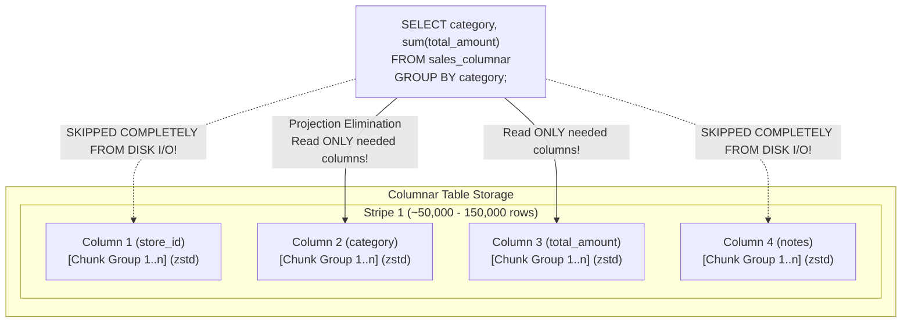

# Example 09: Columnar Storage & Mixed Hot/Cold Architectures

## Overview

Analytical databases frequently store historical events, logs, and telemetry that are rarely updated but scanned across billions of rows. Standard PostgreSQL row-oriented storage (`heap`) stores entire tuples consecutively on disk with alignment padding, tuple headers, and row locks.

**Citus Columnar (`USING columnar`)** provides a columnar table access method that:
1. **Compresses data up to 10x-50x** using `zstd`, `lz4`, or `pglz`.
2. **Projects only requested columns** during query execution (`ColumnarScan`), drastically cutting I/O bandwidth.
3. **Pairs with declarative partitioning** to build **Mixed Hot/Cold architectures**: active recent data remains in `heap` for fast singleton mutations, while historical data is stored in `columnar` for dense compression and fast parallel analytical scans.

Primary references:
- [Citus Columnar Storage Documentation](https://docs.citusdata.com/en/v12.0/admin_guide/columnar.html)
- [`alter_columnar_table_set` SQL Reference](https://docs.citusdata.com/en/v12.0/develop/reference_sql.html#alter-columnar-table-set)

---

## Columnar Storage Structure & Striping



---

## Core Citus Columnar Primitives

### 1. Creating a Columnar Distributed Table
```sql
CREATE TABLE historical_sales_columnar (
    store_id int NOT NULL,
    order_id bigint NOT NULL,
    customer_id bigint NOT NULL,
    category text NOT NULL,
    quantity int NOT NULL,
    unit_price numeric(10,2) NOT NULL,
    total_amount numeric(10,2) NOT NULL,
    order_date date NOT NULL,
    status text NOT NULL,
    notes text
) USING columnar;

SELECT create_distributed_table('historical_sales_columnar', 'store_id');
```

### 2. Tuning Compression and Stripe Limits
```sql
SELECT alter_columnar_table_set(
    'historical_sales_columnar',
    compression       => 'zstd',  -- zstd, lz4, pglz, or none
    compression_level => 3,       -- level 1-19 for zstd
    stripe_row_limit  => 50000    -- rows per stripe before creating a new stripe
);
```

### 3. Mixed Hot/Cold Partitioning Pattern
Combine standard `heap` with `columnar` child partitions under a single partitioned table:
```sql
CREATE TABLE partitioned_order_ledger (
    store_id int NOT NULL,
    order_id bigint NOT NULL,
    order_date date NOT NULL,
    amount numeric(10,2) NOT NULL,
    status text NOT NULL,
    PRIMARY KEY (store_id, order_date, order_id)
) PARTITION BY RANGE (order_date);

-- Hot Partition: Active current month (heap allows singleton UPDATE/DELETE)
CREATE TABLE ledger_hot_2026_11 PARTITION OF partitioned_order_ledger
    FOR VALUES FROM ('2026-11-01') TO ('2026-12-01')
    USING heap;

-- Cold Partition: Prior closed month (columnar with zstd)
CREATE TABLE ledger_cold_2026_10 PARTITION OF partitioned_order_ledger
    FOR VALUES FROM ('2026-10-01') TO ('2026-11-01')
    USING columnar;

SELECT create_distributed_table('partitioned_order_ledger', 'store_id');
```

---

## File Structure

```
examples/09-columnar-storage/
├── README.md       # Architecture diagram, striping guide, benchmarks, limitations
├── schema.sql      # Pure columnar, heap, and mixed hot/cold partitioned tables
├── data.sql        # 20,000 sales records and 10,000 ledger records
├── queries.sql     # Footprint comparison, columnar scan projection, hot/cold operations
├── verify.sh       # Executable test harness
├── verify.sql      # Automated assertions (storage formats, row parity, compression ratio)
└── cleanup.sql     # Teardown script
```

---

## How to Run & Verify

### 1. Execute the Automated Suite
```bash
./examples/09-columnar-storage/verify.sh
```

### Expected Output
```text
=== [09-columnar-storage] Starting Test Suite ===
--> Verifying Citus coordinator connection...
/var/run/postgresql:5432 - accepting connections
--> Ensuring citus_columnar extension is loaded across coordinator and worker nodes...
--> Applying schema.sql (columnar, heap, and mixed hot/cold partitioned tables)...
--> Ingesting 20,000 sales records and 10,000 ledger records via data.sql...
--> Executing queries.sql (storage footprint, columnar scans, hot/cold operations)...
      storage_format       | formatted_size |  bytes  
---------------------------+----------------+---------
 historical_sales_heap     | 6784 kB        | 6946816
 historical_sales_columnar | 128 kB         |  131072
(2 rows)

 compression_ratio_x 
---------------------
               53.00
(1 row)
--> Running automated verification assertions...
NOTICE:  ------------------------------------------------------------
NOTICE:  Running Verification Suite: 09-columnar-storage
NOTICE:  ------------------------------------------------------------
NOTICE:  [PASS] All tables registered as distributed relations in Citus
NOTICE:  [PASS] Mixed partition storage verified: Hot partition uses heap, Cold partition uses columnar
NOTICE:  [PASS] Row count parity verified: Columnar=20000, Heap=20000, Ledger=10000
NOTICE:  [PASS] Columnar compression confirmed: Heap=6946816 bytes vs Columnar=131072 bytes (Compression Ratio: 53.00x)
NOTICE:  [PASS] Hot heap partition mutation successfully verified
NOTICE:  ------------------------------------------------------------
NOTICE:  ALL VERIFICATION ASSERTIONS PASSED FOR EXAMPLE 09
NOTICE:  ------------------------------------------------------------
=== [09-columnar-storage] ALL CHECKS PASSED SUCCESSFULLY ===
```

---

## Performance & EXPLAIN Analysis

### 1. Columnar Projection Elimination
Notice the `Columnar Projected Columns` in the EXPLAIN plan:
```text
-> Custom Scan (ColumnarScan) on historical_sales_columnar
   Columnar Projected Columns: category, quantity, unit_price, total_amount
```
The unreferenced columns (`notes`, `customer_id`, `order_date`, `status`, `order_id`) were completely excluded from disk reads.

### 2. Mixed Hot/Cold Unified Append
```text
Append (cost=0.00..113.81 rows=5000 width=17)
  -> Custom Scan (ColumnarScan) on ledger_cold_2026_10 (October 2026)
        Columnar Projected Columns: order_date, amount, status
  -> Seq Scan on ledger_hot_2026_11 (November 2026)
```
The optimizer planned a heterogeneous scan: scanning compressed columnar blocks for historical data and heap pages for live data.

---

## Pitfalls & Known Limitations

1. **No Singleton `UPDATE` or `DELETE` on Columnar**: Columnar storage is append-only. Executing `UPDATE` or `DELETE` on a columnar table triggers:
   `ERROR: UPDATE and CTID scans not supported for ColumnarScan`. Use the mixed hot/cold partitioning pattern to keep mutable data in heap.
2. **No `ON CONFLICT` (Speculative Inserts / Upserts)**: Columnar tables do not support `INSERT ... ON CONFLICT DO UPDATE / DO NOTHING` (`columnar_tuple_insert_speculative not implemented`).
3. **No Secondary B-Tree Indexes**: Columnar tables cannot have secondary B-Tree indexes. Columnar scan performance relies on chunk projection and min/max chunk metadata filtering.
4. **No Foreign Keys**: Foreign keys cannot reference or be defined on columnar tables.
5. **Worker Extension Loading**: The `citus_columnar` extension must be installed on all worker nodes as well as the coordinator (`SET citus.enable_ddl_propagation = off; CREATE EXTENSION citus_columnar;`).
