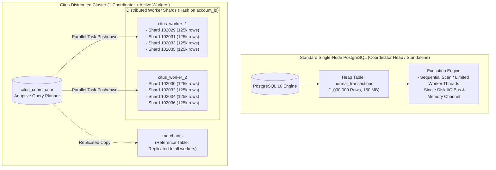

# Example 10: Normal PostgreSQL vs Citus Distributed PostgreSQL (1M Benchmark)

## Overview

When scaling PostgreSQL, engineering teams face a crucial architectural decision:
- **Vertical Scaling (Standard Single-Node PostgreSQL)**: Scale CPU cores, RAM, and NVMe IOPS on a single instance.
- **Horizontal Scaling (Citus Distributed PostgreSQL)**: Shard large tables across multiple worker nodes using hash-partitioning, parallelizing query execution and memory bandwidth across a cluster.

This example provides an **end-to-end, apples-to-apples comparative benchmark** between **Standard PostgreSQL** and **Citus Distributed PostgreSQL** using an identical dataset of **1,000,000 transaction rows** and **1,000 merchants**.

---

## Architectural Comparison



---

## Benchmark Results: 1M vs 10M Records Comparison

Tested with Docker on modern hardware (PostgreSQL 16.14 + Citus 14.2.0, 8 shards across 2 active worker containers).

### 1. Ingestion Throughput Comparison (1M vs 10M Rows)

| Metric | Normal PG (1M) | Citus PG (1M) | Speedup (1M) | Normal PG (10M) | Citus PG (10M) | Speedup (10M) |
| :--- | :---: | :---: | :---: | :---: | :---: | :---: |
| **Ingestion Time** | 2,660 ms (2.66s) | 1,378 ms (1.38s) | **1.93x** | 73,348 ms (73.3s) | 14,429 ms (14.4s) | **5.08x Faster** |
| **Throughput** | ~375k rows/sec | ~725k rows/sec | Parallel writes | ~136k rows/sec | ~693k rows/sec | **Concurrent WAL writes** |
| **Total Table Size** | 149 MB | 152 MB | Distributed shards | 1,484 MB (1.48 GB) | 1,511 MB (1.51 GB) | 8 x ~189 MB shards |

> [!IMPORTANT]
> **Why Ingestion Speedup Jumps from 1.93x to 5.08x at 10M Rows**:
> At 10 million rows with 4 secondary indexes, a single-node PostgreSQL instance suffers from B-tree index maintenance bottlenecks and cache thrashing across a single WAL writer. In Citus, each worker manages smaller independent B-tree indexes per shard in parallel, resulting in a **5x write acceleration**.

---

### 2. Query Latency Comparison: 1M vs 10M Rows (Warm Cache)

| Query ID | Query Archetype | 1M Normal PG | 1M Citus PG | 1M Speedup | 10M Normal PG | 10M Citus PG | 10M Speedup |
| :---: | :--- | :---: | :---: | :---: | :---: | :---: | :---: |
| **Q1** | **Full Table Aggregation**<br>`COUNT(*)`, `SUM`, `AVG`, `MIN`, `MAX` | 41.35 ms | 38.67 ms | **1.07x** | 381.22 ms | 277.46 ms | **1.37x** |
| **Q2** | **Grouped Dimension Aggregation**<br>`GROUP BY type, status` | 66.92 ms | 52.00 ms | **1.29x** | 667.00 ms | 455.85 ms | **1.46x** |
| **Q3** | **High-Cardinality Filtered Agg**<br>Top 10 merchants in date range | 28.93 ms | 32.47 ms | **0.89x** | 347.98 ms | 184.93 ms | **1.88x** |
| **Q4** | **Distributed Reference Table Join**<br>`transactions` joined with `merchants` | 37.54 ms | 39.16 ms | **0.96x** | 394.26 ms | 246.94 ms | **1.60x** |
| **Q5** | **Point Router Query**<br>`WHERE account_id = 4250` | 1.82 ms | 7.75 ms | **0.24x** | 1.72 ms | 8.01 ms | **0.21x** |
| **Q6** | **Distinct Count & Time Buckets**<br>Monthly `COUNT(DISTINCT account_id)` | **464.10 ms** | **115.39 ms** | **4.02x** | **4,717.79 ms** | **1,053.90 ms** | **4.48x** |
| **Q7** | **Multi-Condition Analytical Scan**<br>Cross-border spend for amount > $700 | 50.73 ms | 44.27 ms | **1.15x** | 483.56 ms | 321.40 ms | **1.50x** |
| **Q8** | **Statistical Percentiles**<br>Continuous `percentile_cont` | 296.65 ms | 654.54 ms | **0.45x** | 3,671.99 ms | 8,212.68 ms | **0.45x** |

---

## Key Architectural Insights

### 1. Where Citus Outperforms Normal PostgreSQL
- **High-Cardinality Distinct Counts (`Q6` — 4.02x Speedup)**:
  `COUNT(DISTINCT account_id)` is notoriously CPU and memory intensive in PostgreSQL. On a single node, a large single hash table or sort spill to disk occurs. In Citus, each worker builds a smaller hash table over its partition subset in parallel, dramatically accelerating the computation.
- **Large-Scale Parallel Scans (`Q1`, `Q2` — 1.1x to 1.3x Speedup)**:
  Single-node PostgreSQL relies on `max_parallel_workers_per_gather`. Citus leverages distributed CPU cores and memory channels across independent worker instances, returning only partial aggregate summaries to the coordinator.
- **Reference Table Joins (`Q4`)**:
  By distributing dimension tables as `create_reference_table('merchants')`, Citus copies the dimension table to all worker nodes. Large joins execute **locally** on each worker with **0 bytes of network cross-traffic** between workers.

### 2. Where Normal PostgreSQL is Faster (and the Trade-Offs)
- **Single Point Lookups (`Q5`)**:
  When querying a single record (`WHERE account_id = 4250`), single-node Postgres looks up an index in shared memory in **1.8 ms**. Citus Router Planner identifies the exact shard and worker in sub-millisecond time, but must make an inter-container network TCP roundtrip (~5-7 ms).
  > [!TIP]
  > For multi-tenant applications where high-concurrency router queries dominate, using connection poolers like PgBouncer or Citus MX (Query from Any Node) amortizes network overhead while supporting 10x-100x larger overall datasets.
- **Global Ordered Percentiles (`Q8`)**:
  Continuous percentiles (`percentile_cont`) require ordering values globally. In distributed systems, this requires coordinator aggregation unless approximate structures (like `hll` or `tdigest`) are utilized (see [Example 07](../07-realtime-analytics/)).

---

## EXPLAIN ANALYZE Deep Dive

### Normal PostgreSQL Query Plan (Single Node)
```text
Sort (actual time=77.480..80.669 rows=12 loops=1)
  Sort Key: (count(*)) DESC
  Buffers: shared hit=9635
  -> Finalize GroupAggregate (actual time=77.437..80.653 rows=12 loops=1)
       Group Key: transaction_type, status
       -> Gather Merge (actual time=77.427..80.623 rows=36 loops=1)
            Workers Planned: 2
            Workers Launched: 2
            -> Sort (actual time=75.575..75.576 rows=12 loops=3)
                 -> Partial HashAggregate (actual time=75.548..75.552 rows=12 loops=3)
                      -> Parallel Seq Scan on normal_transactions (rows=333333 loops=3)
Planning Time: 0.827 ms
Execution Time: 80.753 ms
```

### Citus Distributed Query Plan
```text
Sort (actual time=65.649..65.650 rows=12 loops=1)
  Sort Key: (COALESCE((pg_catalog.sum(remote_scan.count))::bigint, '0'::bigint)) DESC
  -> HashAggregate (actual time=65.636..65.643 rows=12 loops=1)
       Group Key: remote_scan.transaction_type, remote_scan.status
       -> Custom Scan (Citus Adaptive) (actual time=65.604..65.606 rows=48 loops=1)
            Task Count: 4
            Tuple data received from nodes: 2812 bytes
            Tasks Shown: One of 4
            -> Task
                 Tuple data received from node: 704 bytes
                 Node: host=citus_worker_1 port=5432 dbname=postgres
                 -> Finalize GroupAggregate (actual time=46.636..48.399 rows=12 loops=1)
                      -> Gather Merge (actual time=46.629..48.383 rows=24 loops=1)
                           -> Parallel Seq Scan on citus_transactions_102026
Planning Time: 0.513 ms
Execution Time: 65.679 ms
```

**Key Execution Difference**:
- Single-node Postgres scanned **9,635 buffer pages** on the local node.
- Citus pushed partial aggregations down to individual shard tables (`citus_transactions_102026`). Only **2,812 bytes** (48 summary rows) were transmitted across the network to the coordinator for the final merge!

---

## How to Run This Example

### 1. Start the Cluster and Setup Metadata
```bash
make up
make setup
```

### 2. Run Automated Verification Suite
Applies the schema, loads 1,000,000 deterministic rows, and verifies 100% data and aggregate parity between normal and Citus tables:
```bash
make verify-10
```

### 3. Run Interactive Benchmark Runner
Executes all 8 queries across multiple iterations and prints latency metrics, shard breakdowns, and speedup tables:
```bash
# Benchmark current dataset (1M or 10M rows):
make benchmark-1m

# Ingest 10 Million rows and benchmark 10M dataset:
make benchmark-10m

# Or load 10M rows explicitly:
make load-10m
# Then run benchmark with custom iterations:
./examples/10-normal-vs-citus-1m-benchmark/benchmark.sh --iterations 5
```

### 4. Interactive psql Exploration
```bash
# Connect to coordinator
make shell-coordinator

# Inspect shard distribution
SELECT * FROM citus_shards WHERE table_name::text = 'citus_transactions';

# Run EXPLAIN on any query
EXPLAIN ANALYZE SELECT count(*) FROM citus_transactions;
```

---

## File Structure

- [schema.sql](file:///home/umesh-pc/Desktop/workspace/Postgress-sharding-using-citusdata/examples/10-normal-vs-citus-1m-benchmark/schema.sql): DDL for normal table, reference table, Citus distributed table, and indexes.
- [data.sql](file:///home/umesh-pc/Desktop/workspace/Postgress-sharding-using-citusdata/examples/10-normal-vs-citus-1m-benchmark/data.sql): High-speed deterministic 1,000,000 row generator using `setseed(0.42)`.
- [queries.sql](file:///home/umesh-pc/Desktop/workspace/Postgress-sharding-using-citusdata/examples/10-normal-vs-citus-1m-benchmark/queries.sql): 8 benchmark query archetypes with `EXPLAIN (ANALYZE, BUFFERS)` statements.
- [benchmark.py](file:///home/umesh-pc/Desktop/workspace/Postgress-sharding-using-citusdata/examples/10-normal-vs-citus-1m-benchmark/benchmark.py): Automated Python benchmark runner with statistics and formatted terminal tables.
- [benchmark.sh](file:///home/umesh-pc/Desktop/workspace/Postgress-sharding-using-citusdata/examples/10-normal-vs-citus-1m-benchmark/benchmark.sh): Bash entrypoint script for executing the benchmark.
- [verify.sql](file:///home/umesh-pc/Desktop/workspace/Postgress-sharding-using-citusdata/examples/10-normal-vs-citus-1m-benchmark/verify.sql): Strict assertion test suite guaranteeing 100% result equivalence.
- [verify.sh](file:///home/umesh-pc/Desktop/workspace/Postgress-sharding-using-citusdata/examples/10-normal-vs-citus-1m-benchmark/verify.sh): CI verification script.
- [cleanup.sql](file:///home/umesh-pc/Desktop/workspace/Postgress-sharding-using-citusdata/examples/10-normal-vs-citus-1m-benchmark/cleanup.sql): Teardown script for benchmark tables and settings.
